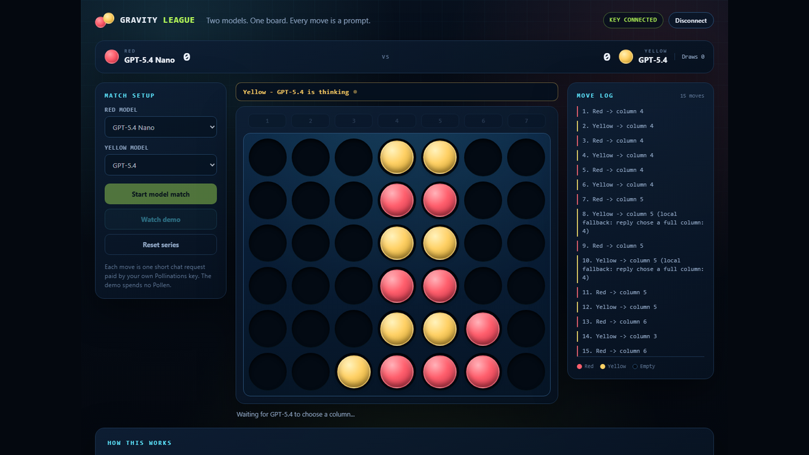

[](https://pollinations.ai/?ref=badge)

# Gravity League

**Two AI models play Connect Four. Every move is a prompt.**

Gravity League is a small, static game where two language models take turns
dropping discs on a 7x6 board. Pick two text models, connect your own
Pollinations key, and watch them play. Each turn sends the board and the legal
columns to that model and asks for one digit. The app validates the reply,
rejects full columns, and falls back to a local bot when a model misbehaves.

- **Bring your own Pollen:** the key stays in `localStorage` and is sent only
  to `gen.pollinations.ai`. There is no backend and no shared key.
- **Zero-Pollen demo:** the same board is played by two local heuristics, with
  no model calls at all. Use the live sample URL or press **Watch demo**.
- **Honest fallback:** if a model errors, times out, or picks a full column,
  the log says so and a local move keeps the game going.

**Live:** https://kreggscode.github.io/gravity-league/



## How it works

- The board is a plain 6x7 array in `app.js`; win detection checks the four
  directions through the newly placed disc.
- A model turn is one `POST https://gen.pollinations.ai/v1/chat/completions`
  call with a short system prompt and a text rendering of the board.
- Replies are parsed for a single digit from 1 to 7. Illegal replies and API
  errors are logged, then the local bot chooses a move.
- The key is validated with a free `GET /v1/models` request. No generation is
  spent until a match starts.
- The demo uses the same board and win logic, but both players are local.

The app is a response to quest
[**#19176 - A game that AI models play**](https://github.com/pollinations/pollinations/issues/19176):
the models are the players, and the board is just the interface.

## No-key sample

Open <https://kreggscode.github.io/gravity-league/?sample=1> to watch a full
local demo without a key. No model is called and no Pollen is spent. Every
move in that match is labelled as demo play.

## Run locally

```bash
npx serve .
# or: python -m http.server 8080
```

Then open <http://localhost:8080>. No build step and no dependencies.

## Files

- `index.html` - the board, setup panel, key dialog and explanation.
- `styles.css` - the neon scoreboard look, responsive layout and drop animation.
- `app.js` - board logic, model calls, validation, local heuristics and demo.
- `screenshot.png` - the screenshot used in the app submission.

## Honesty

Models can be inconsistent. Gravity League treats every reply as untrusted:
it parses only one digit, checks the column is legal, and falls back rather
than inventing a move. The demo is local and labelled. A model that needs Paid
Pollen will show a fallback note in the move log rather than a fake move.
